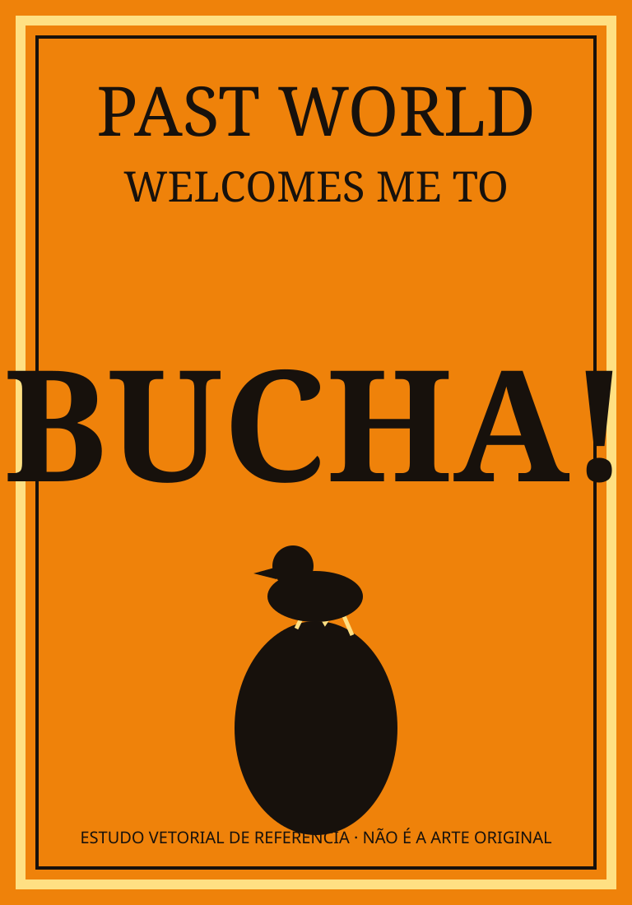
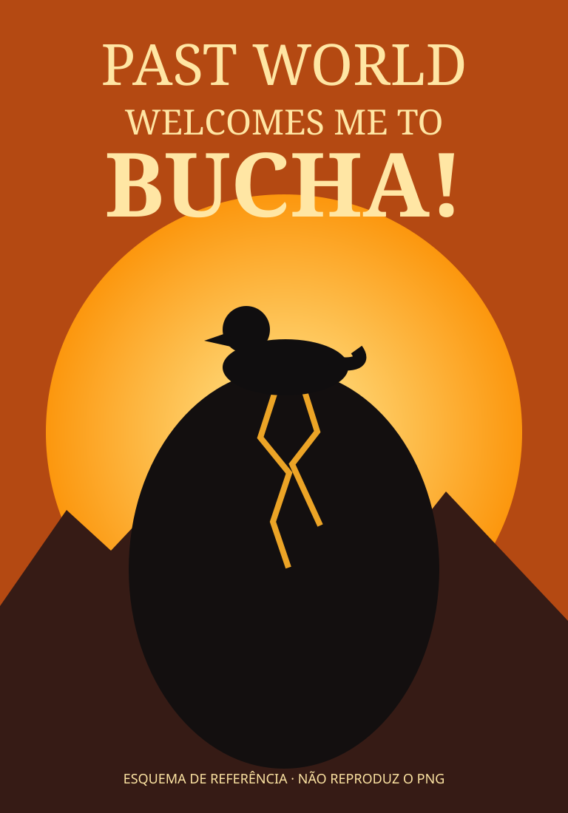

# Catálogo dos arquivos gráficos e rastreabilidade

**Atualização:** 2026-10-16.

A conversa contém a imagem original e cinco ilustrações editadas/criadas para «PAST WORLD WELCOMES ME TO BUCHA!»:

| ID | Material | Arquivo PNG disponível originalmente na conversa | Descrição | Situação |
|---|---|---|---|---|
| IMG-00 | Capa original fornecida por Samuel | `A4 .png` | Laranja vivo, moldura amarela, tipografia preta, patinho em ovo negro | Arquivo de origem local |
| IMG-01 | Retroeditorial de luxo | `a_flat_graphic_vintage_retro_book_cover_style_po.png` | Papel laranja envelhecido, decoração estelar, serifa pesada, patinho e ovo | Gerada no chat |
| IMG-02 | Manifesto tipográfico | `a_bold_graphic_poster_book_cover_style_image_vint.png` | Palavra BUCHA! gigantesca, alto contraste, ave diminuta | Gerada no chat |
| IMG-03 | Surrealismo Buchacore | `a_bold_vintage_poster_style_book_cover_illustratio.png` | Ovo negro em paisagem surreal, sol amplo, água e rochas | Gerada no chat |
| IMG-04 | Art Déco imperial | `pôster_art_déco_do_pato_e_ovo.png` | Ouro, preto, arquitetura escalonada, geometria imperial | Gerada no chat |
| IMG-05 | Distopia pop | `o_pato_sobre_o_ovo_monolítico.png` | Ovo e sol monumentais, cidade em ruínas, laranja ferrugem | Gerada no chat |

**Política de verdade dos arquivos:** os PNG originais da conversa **não foram incorporados ao GitHub por estas operações de texto**, porque os métodos disponíveis de edição textual não transferem automaticamente binários montados na sessão. No repositório, os arquivos SVG `ESQUEMA-REFERENCIA-*.svg` são **reinterpretações vetoriais esquemáticas novas**, não os PNG originais. O pacote ZIP dos seis PNG pode ser oferecido separadamente para upload manual, mantendo os nomes acima. Não renomear esquemas como se fossem artes originais.

## Miniaturas editoriais esquemáticas da paleta

## Metadados que toda imagem futura deverá manter

- `id` estável e caminho.
- `livro` de origem, sem misturar séries.
- `data_criacao_conhecida` e `ultima_atualizacao`.
- `tipo`: imagem enviada pelo autor / imagem gerada / esquema de referência.
- `prompt_documental` com especificações de texto, hierarquia, símbolos e paleta.
- `fonte`, `estado_aprovacao`, `historico_de_revisoes`.
- `descricao_visual`, `acessibilidade`, `direitos`.
- `arquivo_binario_verificado_no_repositorio`: verdadeiro apenas após upload.
- `nao_pertence_ao_evangelho` quando aplicável.

## Continuidade visual

A imagem do pato e do ovo não constitui fato da cosmologia do Evangelho, nem imagem profética atribuída ao autor. Qualquer arte dedicada ao Evangelho exigirá nova proposta de símbolos, título e aprovação.
